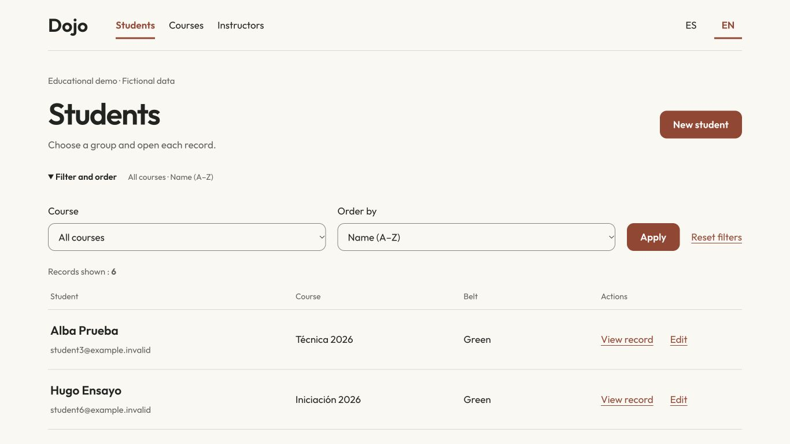
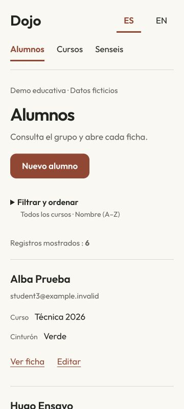
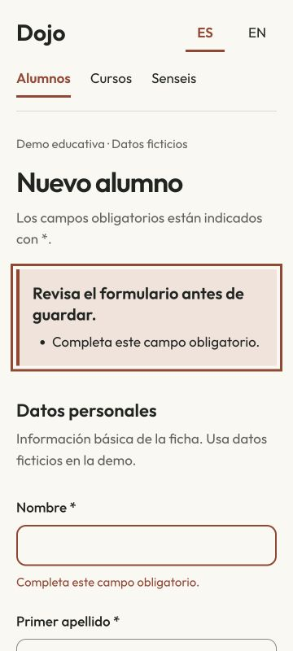

# Dojo: fichas y formularios

[English](README.md) · [Más proyectos](https://github.com/navalcode)

## Resumen

Revisión de una aplicación formativa DAM para alumnos, cursos y senseis, con páginas Thymeleaf y **28 pruebas locales**: contexto original, 23 recorridos MVC/JPA y cuatro contratos de grafo. Conserva su atribución y herramientas originales.

La interfaz usa Outfit local, papel/tinta/cobre, filas abiertas y formularios con etiquetas. Español por defecto con recursos ingleses completos. Los filtros móviles usan un desplegable nativo; sin JavaScript, filtros y formularios siguen disponibles. Se pueden combinar curso y orden por edad/nombre, consultar detalle y crear/editar los tres tipos de entidad.



## Ejecutar

La verificación usa JDK 17; el POM conserva el objetivo Java 11. Desde la raíz del repositorio:

```sh
cd DojoNavalManuel
sh ./mvnw verify
java -jar target/dojonavalmanuel-0.0.1-SNAPSHOT.jar
```

Tomcat imprime el puerto asignado. Abre esa dirección loopback en un navegador. H2 funciona en memoria y se reinicia al terminar el proceso. La demo incluye seis alumnos, dos cursos y dos senseis ficticios; los contactos usan example.invalid y no se cargan fotos inicialmente.

La persistencia en fichero es opcional y explícita. Desde el mismo directorio del módulo:

```sh
mkdir -p demo-data
java -jar target/dojonavalmanuel-0.0.1-SNAPSHOT.jar '--spring.datasource.url=jdbc:h2:file:./demo-data/dojo;DB_CLOSE_ON_EXIT=FALSE'
```

La comprobación aislada de crear/cerrar/reiniciar conserva una ficha añadida sin duplicar los datos iniciales. La ruta de la base de datos anterior no se abre por defecto. `DOJO_DATABASE_URL` y `DOJO_PORT` son alternativas opcionales de configuración.

## Comportamientos revisables

| Acción | Resultado |
|---|---|
| Crear/editar desde los formularios | Valida antes de escribir y conserva los datos al mostrar errores |
| Cambiar idioma durante la edición | Envía el borrador para traducirlo sin guardarlo |
| GET de una URL de borrado | Confirmación sin mutación; cancelar conserva la ficha |
| Confirmar borrado mediante POST | Exige token y sesión del formulario; elimina una ficha apta |
| Eliminar curso/sensei con dependencias | 409, explicación y enlace para continuar |
| Abrir una ficha ausente | Página de recuperación 404 |
| Token ausente/inválido | Página 403, sin volver a rechazar el despacho del error |

Los modelos de entrada nuevos usan campos ingleses y evitan enlazar directamente entidades. Se conservan las rutas de navegación; los clientes de formularios anteriores necesitan los campos y token nuevos. Los contactos son opcionales. Una URL de imagen introducida explícitamente puede cargar una imagen externa; los datos iniciales no dependen de fotos/iconos/fuentes remotos.

Lee [los recorridos MVC/JPA](DojoNavalManuel/src/test/java/com/salesianostriana/dam/DojoHttpJourneyTest.java) y después [DojoService](DojoNavalManuel/src/main/java/com/salesianostriana/dam/web/DojoService.java). Las pruebas recargan repositorios después de cada petición sin una transacción que envuelva el test. Los contratos de grafo cubren transferencias, duplicados y retirada desde otro propietario. La eliminación respeta dependencias; los importes se acotan, pero el modelo histórico conserva double.

 

## Verificación y límites

Maven verify supera 28 pruebas sin fallos/errores/omisiones con JDK 17/macOS. El JAR se comprueba además mediante HTTP real: idiomas, rutas, bytes de recursos locales, confirmación y errores; la persistencia opcional se verifica tras reiniciar. Navegador a 1366×768, 360×800 y 800×360, salto de teclado, crear/recargar/editar, cambio de idioma del borrador y filtros combinados. Las capturas son píxeles reales de la aplicación, sin conceptos generados. [Resultados registrados](docs/verification.json).

No se añade CI alojada. Spring Boot 2.4.5 y el wrapper Maven original permanecen fijados; no se presenta como gestor autenticado de producción. No se acredita auditoría formal de lector de pantalla/WCAG, dispositivo físico ni despliegue. [Decisiones de diseño](DESIGN.md) · [Componentes y atribución](THIRD_PARTY.md). Las notas y créditos originales se conservan en el README inglés.
